

<a href="https://mflow.skotechlabs.com">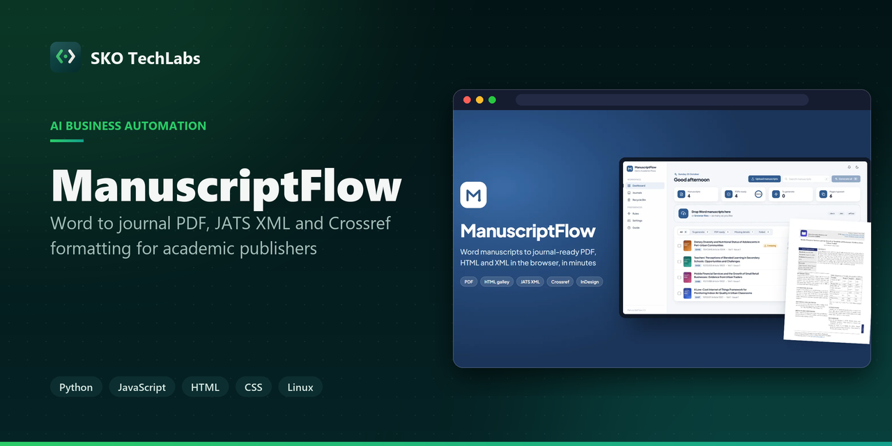</a>

<h3>Word to journal PDF, JATS XML and Crossref formatting for academic publishers</h3>

A web app for academic publishers that turns Word manuscripts into journal-ready PDF, HTML galley, JATS XML and Crossref files in minutes, with a live editor, author proofs and each journal house style built in.

   

<a href="https://mflow.skotechlabs.com"><b>Live Demo</b></a> &nbsp;·&nbsp; <a href="https://skotechlabs.com/projects/manuscriptflow-journal-article-formatting-saas"><b>Case Study</b></a> &nbsp;·&nbsp; <a href="https://skotechlabs.com/contact"><b>Request a Demo</b></a> &nbsp;·&nbsp; <a href="https://github.com/skotechlabs"><b>All Products</b></a>

---

## Overview

Most journal publishers still format every accepted article by hand: the text is copied from Word into a layout program, headings, tables, equations and references are fixed one by one, and the XML for indexing is made separately. One article can take an hour or more, and every new issue means days of layout work.

ManuscriptFlow does this in the browser. The editor drops in Word files, as many as they like. The app reads the title page, authors and affiliations, abstract, keywords, headings, tables, figures, equations and references, applies the journal house style and typesets a finished PDF with the journal cover, an article information box, running headers and the DOI in seconds. The same click makes the HTML galley and JATS XML for OJS and the Crossref deposit file.

Editors correct anything in a Word-like document view next to a live PDF preview, send authors a private proof link where they edit or comment, and accept only the changes they want. It runs as a multi-tenant SaaS: every publisher has its own workspace with its journals, covers, rules and users, and publishers that still finish pages in InDesign can download an IDML file built on their own template.

<table>
<tr>
<td width="50%" valign="top">

### The Challenge

Accepted articles arrive as Word files written in every possible way: headings typed in capitals or numbered, several affiliations on one line, tables with merged cells, equations from different editors, references in mixed styles. Formatting them by hand takes a skilled designer, the result depends on who did it, and the indexing files are a separate job. The software had to read messy manuscripts reliably, produce pages a publisher is happy to print under its own name, and still let a person fix anything in a few clicks.

</td>
<td width="50%" valign="top">

### Our Solution

We built a Python web app around one model of the article. A reader takes the Word file apart down to text runs, tables, equations and pictures; a classifier finds the title page, sections, captions, notes and references and renames headings to the journal standard; house rules then clean the text the way a copy editor would. A built-in typesetting engine lays the article out in two columns with tables and figures placed as floats, the journal cover and the article information box, with no desktop software. The same model is written out as PDF, HTML, JATS XML, Crossref XML and InDesign IDML, so every output says the same thing. Author proofs work on a copy of the article, and the changes are compared word by word so the publisher can accept them one at a time.

</td>
</tr>
</table>

## Key Features

- Upload many Word manuscripts at once (.docx and .doc) and get a typeset PDF for each in seconds
- Reads the title page, authors, affiliations, abstract, keywords, headings, tables, figures, equations and references
- Section headings renamed to the journal standard: Introduction, Materials and Methods, Results and Discussion, Conclusion, References
- Journal PDF with cover page, article information box, two-column layout, running headers, page numbers and DOI
- Word-like document view with paragraph styles, undo and paste from Word, beside a live PDF preview
- Author proof links: the author edits or comments from any device and the publisher accepts changes selectively
- Notifications that open the article right at the author comment
- HTML galley and JATS XML for OJS, Crossref XML for DOI deposit, and a delivery zip with everything
- InDesign IDML export built on the publisher own template, for teams that finish pages in InDesign
- House style rules: APA references, caption numbering, et al. in italics, DOI links, table and note styles
- Journal library with covers, volume, issue and automatic start pages across an issue
- Checks that flag missing details before publishing, and PDF versions kept with a recycle bin
- Multi-tenant SaaS with separate workspaces, users and a free trial for every new publisher

## Business Impact

- A Word manuscript becomes a typeset journal PDF in seconds, with HTML, JATS XML and Crossref files from the same click
- A whole issue can be uploaded and formatted together
- Author corrections arrive as marked changes and comments in the article instead of long email threads
- Every journal keeps its own cover, numbering and house style without a designer
- Publishers can sign up for a free trial and format their own articles the same day

## Screenshots

<table>
<tr>
<td width="50%" valign="top">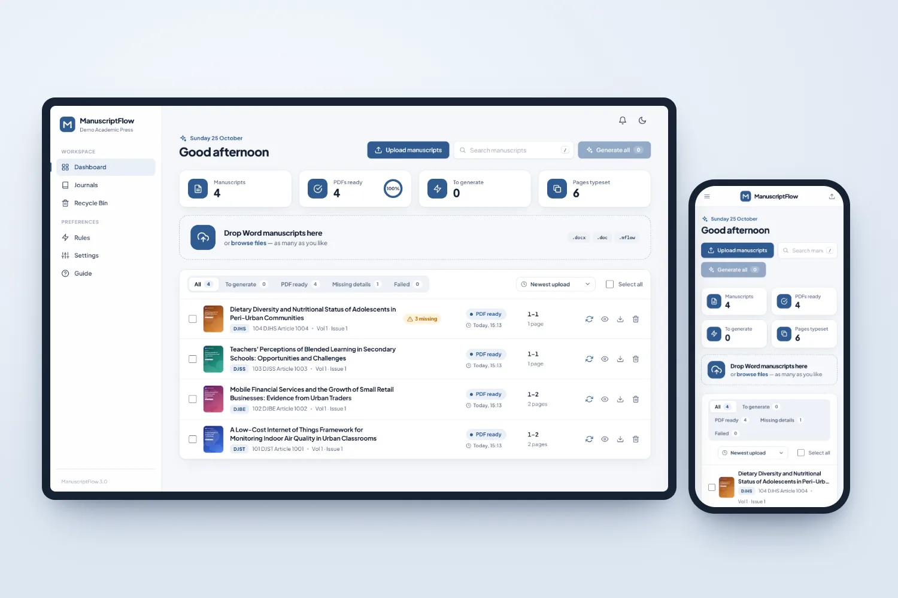 Dashboard on a laptop and a phone: manuscripts, PDFs ready, missing details and the upload area</td>
<td width="50%" valign="top">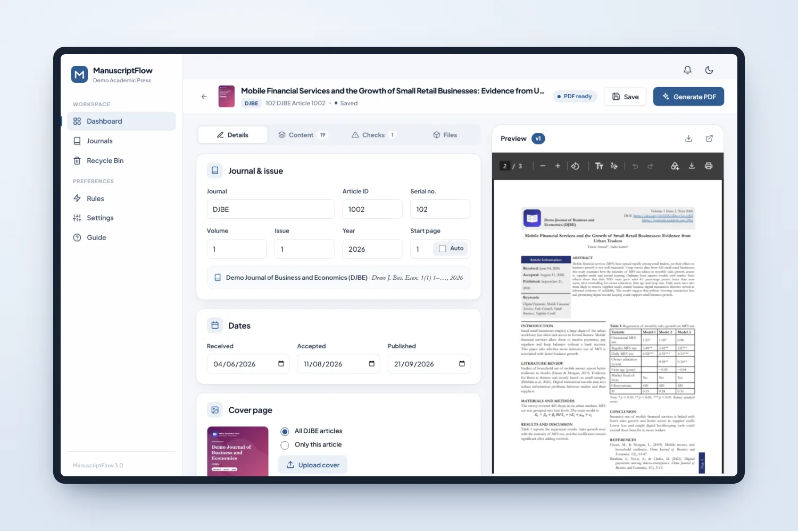 Article editor: journal, issue and dates on the left, the typeset PDF live on the right</td>
</tr>
<tr>
<td width="50%" valign="top">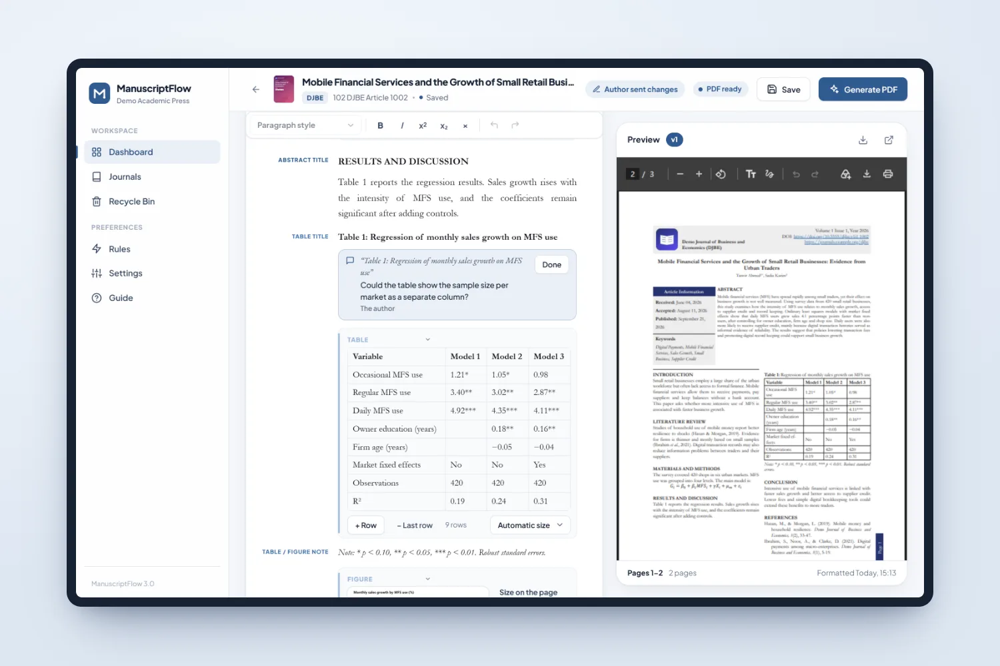 Document view: edit the article like a Word file, with headings, tables, equations and author comments in place</td>
<td width="50%" valign="top">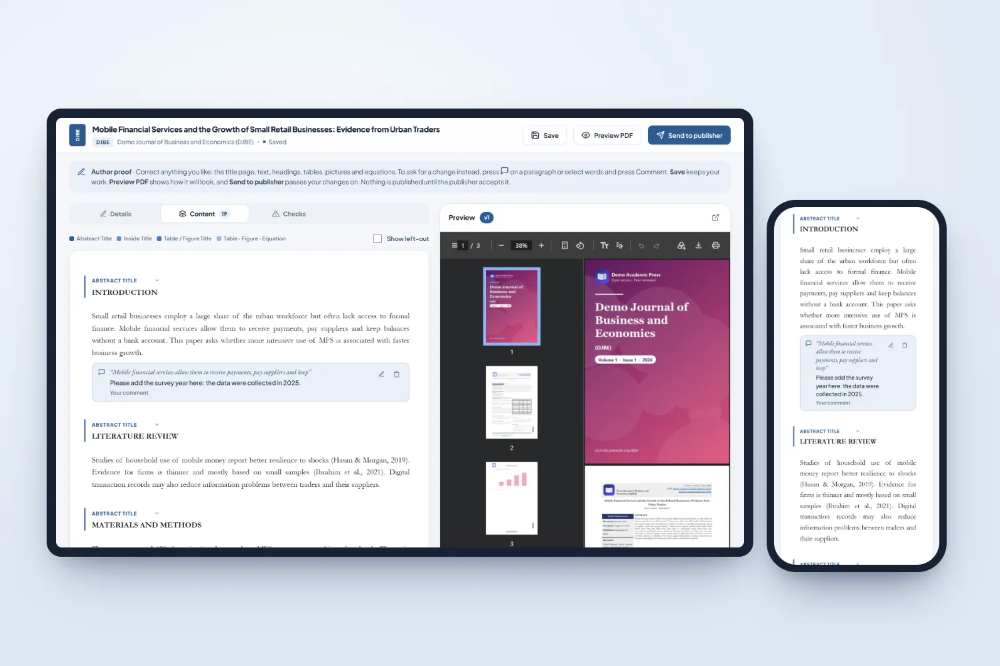 Author proof on laptop and phone: the author corrects the text or leaves comments, and nothing is used until the publisher accepts it</td>
</tr>
<tr>
<td width="50%" valign="top">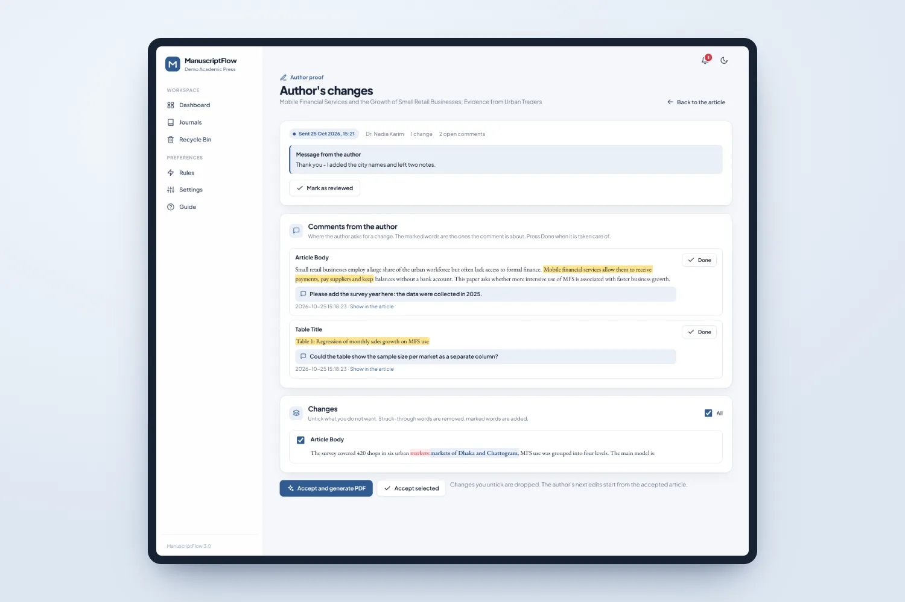 Reviewing the author changes: comments with the marked words, and every edit shown word by word</td>
<td width="50%" valign="top"> A notification opens the article right at the author comment</td>
</tr>
<tr>
<td width="50%" valign="top">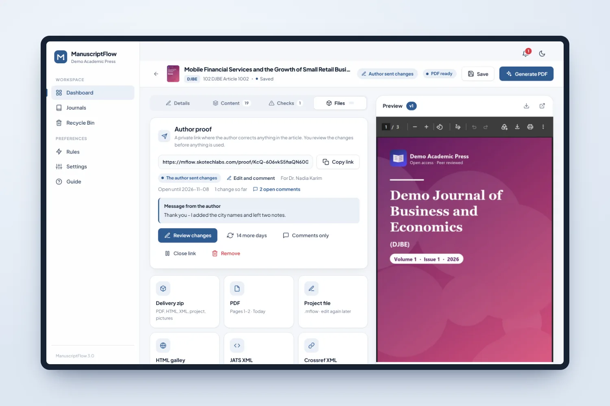 Files: author proof link, delivery zip, PDF, project file, HTML galley, JATS XML and Crossref XML</td>
<td width="50%" valign="top">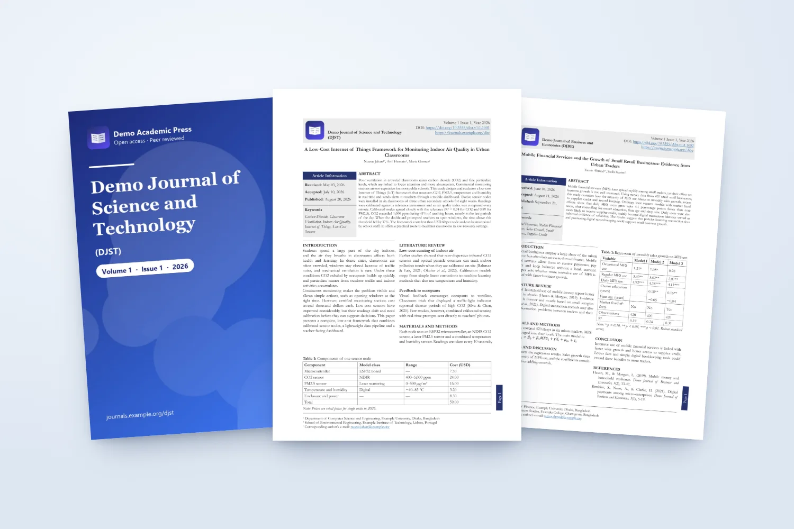 Typeset pages: journal cover, title page with article information, tables, figures and equations</td>
</tr>
<tr>
<td width="50%" valign="top"> HTML galley for OJS, readable on laptop and phone</td>
<td width="50%" valign="top"> Journal library with covers, volume, issue and the next page number</td>
</tr>
<tr>
<td width="50%" valign="top">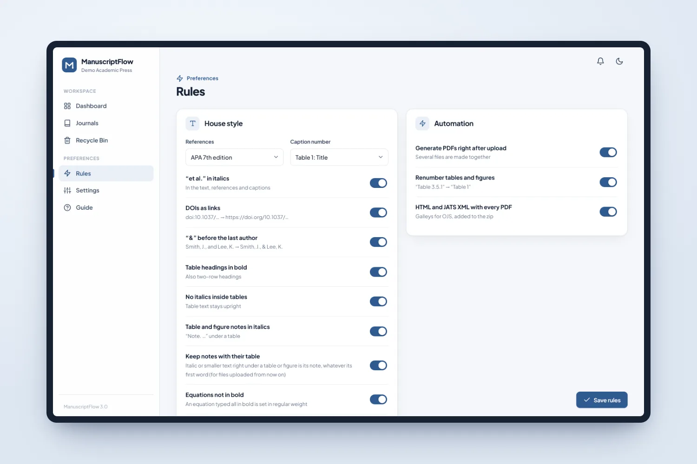 House style rules: reference style, caption numbering, italics, DOI links and automation, each one a switch</td>
<td width="50%" valign="top">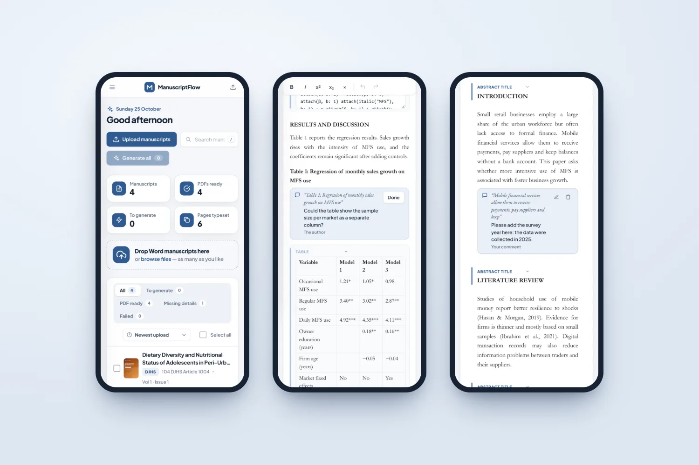 Phone screens: dashboard, document view and the author proof</td>
</tr>
<tr>
<td width="50%" valign="top">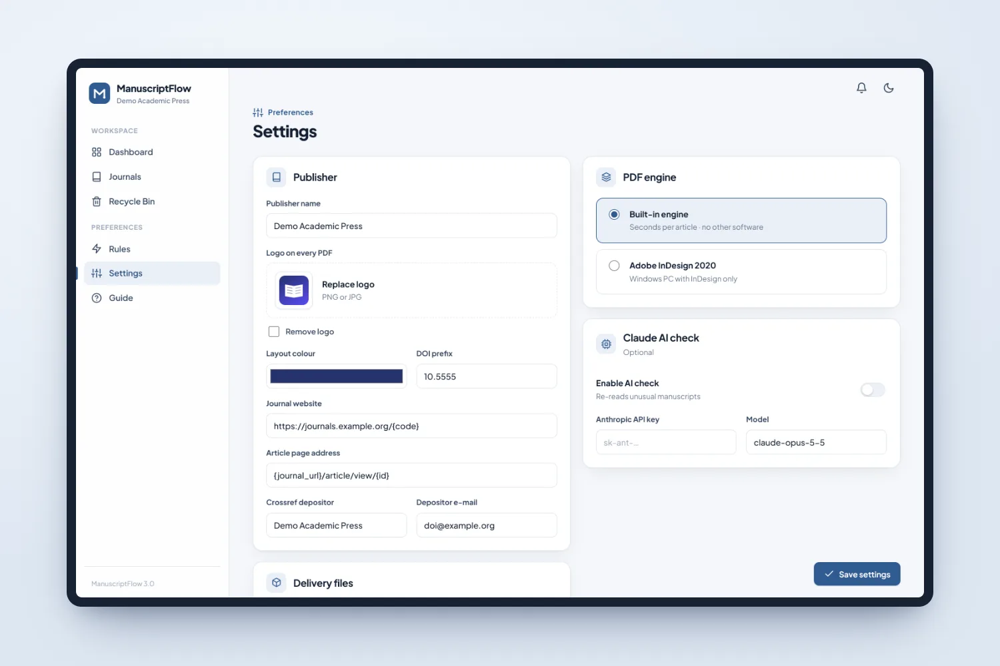 Settings: publisher logo, layout colour, DOI prefix, Crossref depositor and the PDF engine</td>
<td width="50%"></td>
</tr>
</table>

> See it running: **[mflow.skotechlabs.com](https://mflow.skotechlabs.com)**

## Technology Stack

## Source Code & Licensing

This repository is the public showcase for **ManuscriptFlow**. The production source code is proprietary and is maintained privately by SKO TechLabs.

Interested in this product for your business? We offer:

- **Ready-to-launch deployment** of ManuscriptFlow under your own brand and domain
- **Customisation** of features, workflows, languages and integrations to fit how you work
- **Custom development** of a new product built on the same foundations
- **Ongoing support**, hosting, maintenance and feature roll-outs after launch

## Get in Touch

---

© 2026 <a href="https://skotechlabs.com">SKO TechLabs</a> · Dhaka, Bangladesh · Building intelligent digital solutions

